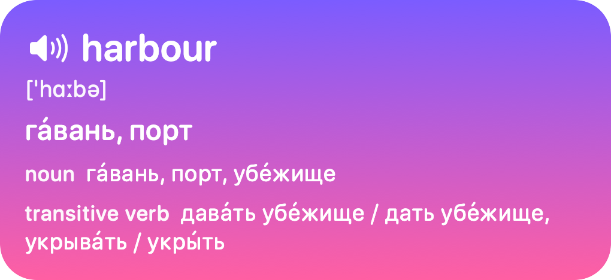
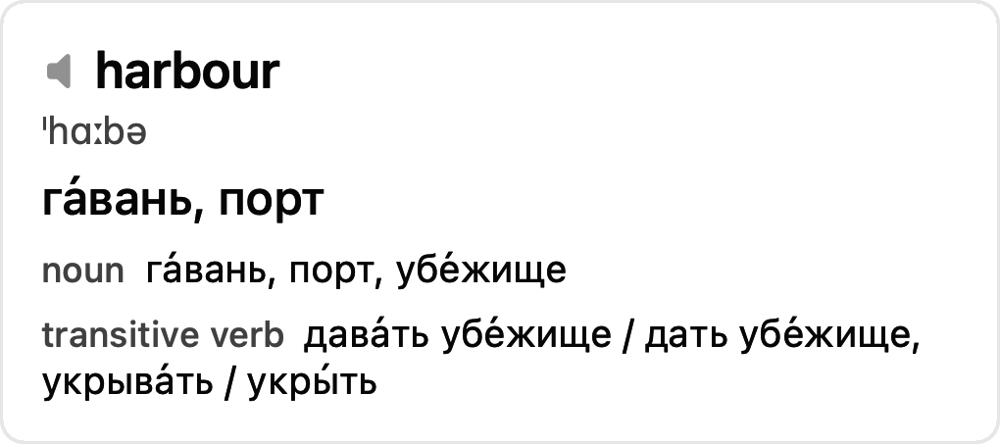
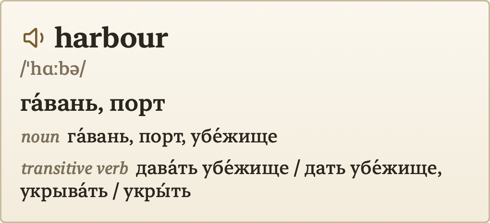

<p align="center">
  
</p>

<h1 align="center">Saytap</h1>

<p align="center">
  Select an English word anywhere on your Mac, tap <b>⌥ Option</b> twice,<br>
  and hear it spoken while its translation pops up next to the cursor.
</p>

<p align="center">
  <a href="https://github.com/vitalyliber/saytap/releases/latest/download/Saytap.dmg">Download</a> ·
  <a href="https://vitalyliber.github.io/saytap/">Website</a> ·
  <a href="#install">Install</a> ·
  <a href="#how-it-works">How it works</a>
</p>

<p align="center">
  
</p>

## Features

- **Works in any app.** Select a word or a phrase and tap ⌥ twice, or press ⌃⌥T. The pop-up appears next to the cursor and stays until you press Esc or click elsewhere. Click it to hear the word again.
- **A real voice on your Mac.** Speech comes from [Phonon](https://gradium.ai/phonon), an open text-to-speech model that runs on the Neural Engine. Nothing is sent to a server, and a word starts playing in about 20 ms. Pick from six voices and eight speeds, from 0.25× to 2×.
- **Dictionary meanings, not just a translation.** Words and phrasal verbs come from the bilingual Oxford dictionary built into macOS, with transcription and meanings grouped by part of speech. It works offline.
- **Phrases and sentences too.** Text the dictionary doesn't have is translated by Google Translate, with Apple's on-device Translation as a fallback.
- **History.** Every look-up is saved on your Mac. Search it, listen to any word again, and delete what you've learnt.
- **Four styles.** Playful, Standard, Minimal and Formal.

<p align="center">
  
  
  
</p>

## How it works

Each look-up tries these sources in order and stops at the first that answers:

1. **The Oxford bilingual dictionary** that ships with macOS: instant and offline. Choosing a language in **Translate to** downloads its dictionary in about a minute.
2. **Your history:** a phrase translated before is reused rather than sent anywhere.
3. **Google Translate's public endpoint**, for phrases the dictionary doesn't have. The text is sent to Google.
4. **Apple's Translation framework**, offline, when Google fails or takes longer than a second. The menu offers to download the language for it.

Speech never leaves the Mac. The history is stored in `~/Library/Application Support/Saytap/history.json`.

The double tap only counts when ⌥ is pressed on its own: two quick taps, each shorter than 0.3 s and less than 0.4 s apart. Any other key, click or modifier in between cancels it, so your ⌥ shortcuts keep working.

## Install

### Download

Download [Saytap.dmg](https://github.com/vitalyliber/saytap/releases/latest/download/Saytap.dmg) (140 MB), open it and drag Saytap into Applications. It's signed with a Developer ID and notarized by Apple. It needs macOS 26 or later on Apple silicon.

Start Saytap from Applications. On the first launch it asks for Accessibility, which it needs to read the selected text: click **Open System Settings** and switch **Saytap** on in Privacy & Security → Accessibility. Then pick your language in the menu bar icon → **Translate to** (see [step 6](#6-pick-the-language)), select a word anywhere and tap ⌥ twice.

### Build from source

Without a paid Apple Developer ID, macOS keeps the Accessibility permission only for an app signed with a certificate the Mac trusts. So to build Saytap yourself, you sign it with a certificate you create in step 2. It takes about ten minutes, most of it downloads.

Use either the download or your own build, not both: they share the app's identity, and the Accessibility permission belongs to one of them at a time.

The steps are written so that an AI coding agent can run them in Terminal. Steps marked **👤** need the person at the Mac: a password, a dialog or a switch in System Settings. An agent should stop there, say exactly what to do, and wait.

Run the steps in order. If Accessibility is granted before the certificate is trusted (step 3), macOS ties the permission to that one build, and the app keeps asking for it; see [Troubleshooting](#troubleshooting).

#### 1. Requirements

- macOS 26 or later, on Apple silicon. Intel Macs aren't supported: Phonon's Core ML model runs on the Neural Engine.
- Swift 6 or later. Check with `swift --version`. If it's missing, run `xcode-select --install`. **👤** Confirm the installer dialog.
- About 650 MB of disk space: the app with its model (170 MB), the copy Core ML compiles on first launch (310 MB), and the build's downloads.

Clone the repository and run the remaining commands from its folder:

```bash
git clone https://github.com/vitalyliber/saytap.git
cd saytap
```

#### 2. Create the signing certificate

Do this once per Mac. Skip it if this command already prints a certificate:

```bash
security find-certificate -c "Saytap Signing"
```

Create the certificate and import it into the login keychain. The temporary folder is removed afterwards, so the private key exists only in the keychain:

```bash
CERT_DIR="$(mktemp -d)"
/usr/bin/openssl req -x509 -newkey rsa:2048 -nodes -days 3650 -subj "/CN=Saytap Signing" \
  -addext "keyUsage=critical,digitalSignature" \
  -addext "extendedKeyUsage=critical,codeSigning" \
  -addext "basicConstraints=critical,CA:false" \
  -keyout "$CERT_DIR/key.pem" -out "$CERT_DIR/cert.pem"
/usr/bin/openssl pkcs12 -export -inkey "$CERT_DIR/key.pem" -in "$CERT_DIR/cert.pem" \
  -name "Saytap Signing" -out "$CERT_DIR/signing.p12" -passout pass:saytap
security import "$CERT_DIR/signing.p12" -k ~/Library/Keychains/login.keychain-db -P saytap -T /usr/bin/codesign
rm -rf "$CERT_DIR"
```

#### 3. Trust the certificate system-wide

**👤** This needs your admin password. macOS checks app permissions as root, so trusting the certificate only in the login keychain is not enough. The trust covers code signing only.

```bash
security find-certificate -c "Saytap Signing" -p > /tmp/saytap-signing.pem
sudo security add-trusted-cert -d -r trustRoot -p codeSign -k /Library/Keychains/System.keychain /tmp/saytap-signing.pem
rm /tmp/saytap-signing.pem
```

Check it. The output should list "Saytap Signing" with Code Signing:

```bash
security dump-trust-settings -d | grep -A3 "Saytap Signing"
```

#### 4. Build and install

```bash
./build.sh
```

This builds the app with Swift Package Manager, installs `~/Applications/Saytap.app` and starts it. A speech bubble icon appears in the menu bar. The first build also fetches Phonon's Swift package (about 50 MB) and its Core ML model (about 140 MB, kept in `build/` for later builds).

**👤** On the first build macOS asks: *"codesign wants to sign using key 'Saytap Signing' in your keychain."* Enter your login password and click **Always Allow**. Until then the build waits.

On the first launch the app compiles the model for this Mac, which takes several seconds; a word looked up meanwhile is spoken once it's done, and the pop-up says the voice is being prepared. Later launches load it in about half a second.

#### 5. Allow Accessibility

**👤** On first launch the app asks for Accessibility access, which it needs to read the selected text. Click **Open System Settings** and switch **Saytap** on in Privacy & Security → Accessibility.

Then restart the app and check that it has the permission. The log must say `Accessibility trusted: 1`:

```bash
pkill -x Saytap; open --stderr /tmp/saytap.log ~/Applications/Saytap.app; sleep 2; cat /tmp/saytap.log
```

#### 6. Pick the language

**👤** Open the menu bar icon → **Translate to** and pick your language, unless the ticked one is already right. By default it's the first language other than English in System Settings → General → Language & Region. If its dictionary isn't downloaded, the app starts the download. If the language isn't downloaded for Apple's offline translation, macOS shows a dialog with a download button next to it; click it, then **Done**. Either can be done later: anything missing is listed under Translate to.

#### 7. Try it

Select a word in any app, for example in Notes, and tap ⌥ twice. You should hear the word and see the pop-up.

## Using it

Everything is in the menu bar icon:

| Menu | What it does |
|---|---|
| **History…** | Every looked-up word with its translation, newest first, with how many times you looked it up. Click a word to hear it, search by word or translation, press ⌫ to delete. A phrase looked up again reuses its saved translation; delete it to translate it afresh. |
| **Translate to** | The language of translations. Languages whose dictionary isn't downloaded are marked. |
| **Voice** | Harper, Hadley, Everly, Maeve, Edwin or Spencer. |
| **Speed** | 0.25, 0.5, 0.75, Normal, 1.25, 1.5, 1.75 or 2. |
| **Style** | Playful (the default), Standard, Minimal or Formal. Choosing one shows the last word in it. |
| **Launch at Login** | Starts Saytap with the Mac. |
| **Saytap Website** | Opens this project's website. |

## Troubleshooting

- **The app asks for Accessibility on every launch, or the log says `Accessibility trusted: 0` although Saytap is switched on.** The saved entry belongs to an older build. Removing and re-adding the app in System Settings doesn't always replace it. Reset it, then switch it on again from the app's prompt:

  ```bash
  tccutil reset Accessibility local.vitaly.saytap; pkill -x Saytap; open ~/Applications/Saytap.app
  ```

  If that doesn't help, check that step 3 was done.

- **`./build.sh` stops at `codesign` and waits.** The keychain dialog from step 4 is open, possibly behind other windows.
- **A double tap of ⌥ only beeps, with no pop-up.** The app found no selected text. Some apps don't expose the selection; the app then copies it with ⌘C, which only works if the app supports copying.
- **The pop-up appears, but there's a beep instead of the word.** Phonon failed to load or speak, and the pop-up's last line says why. For the full error, start the app with its log, look up a word, and read the line starting with `Phonon failed`:

  ```bash
  pkill -x Saytap; open --stderr /tmp/saytap.log ~/Applications/Saytap.app; sleep 10; cat /tmp/saytap.log
  ```

  If the compiled model is broken, delete `~/Library/Application Support/Saytap/Models` and restart the app: it copies and compiles the model again.

## Uninstall

```bash
pkill -x Saytap; rm -rf /Applications/Saytap.app ~/Applications/Saytap.app
tccutil reset Accessibility local.vitaly.saytap
defaults delete local.vitaly.saytap
rm -rf ~/Library/Application\ Support/Saytap
```

**👤** If you built Saytap yourself, then delete the **Saytap Signing** certificate in Keychain Access, from both the login and the System keychain.

## Development

`./build.sh` rebuilds, reinstalls and restarts the app. The certificate keeps the Accessibility permission across rebuilds.

`swift test` runs the unit tests: the dictionary and Google parsers, the order of translation sources, the history and the language menu. They need no network. [CLAUDE.md](CLAUDE.md) describes the code, its pitfalls and how to check changes in the running app.

Phonon's version is pinned twice: the Swift package in `Package.swift` and the Core ML model in `build.sh` (`PHONON_VERSION`, with the archive's SHA-256). Update them together.

Settings are constants in `Sources/Settings.swift`: voices (`PHONON_VOICES`; the model's 37 voices are in `build/Models-*/voices`), hotkey, double-tap modifier and timing, speed presets and the pop-up's size. Rebuild after you change them.

`./dmg.sh` packs an app into `build/Saytap.dmg`, a disk image whose window shows the app, an arrow and Applications to drag it onto. It takes the app `build.sh` installed, or the path of another build: `./dmg.sh path/to/Saytap.app`. [RELEASING.md](RELEASING.md) describes how a Developer ID holder builds, signs and notarizes an installer for others. `dmg-background.swift` draws the window's background.

The website is `docs/index.html`, served by GitHub Pages from the `docs` folder.

## Credits

- [Phonon](https://github.com/gradium-ai/xn-ptts) by Gradium: the Swift package is MIT or Apache-2.0, the model and voices Apache-2.0. `build.sh` downloads the model from its release.
- The Oxford bilingual dictionaries and Apple's Translation come with macOS.
- Translations of phrases come from Google Translate.

## License

[MIT](LICENSE)
